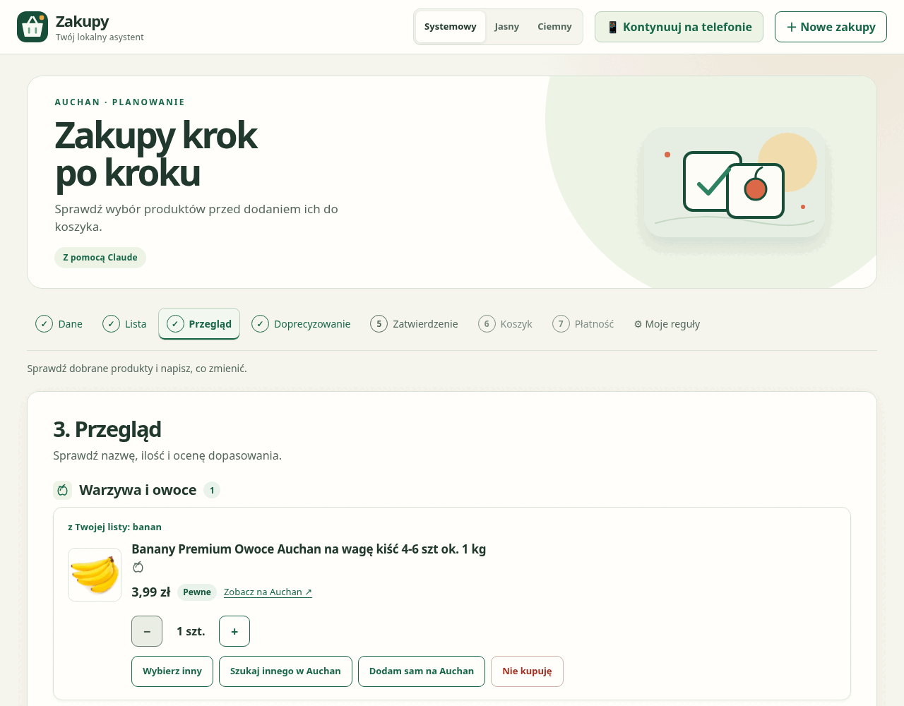
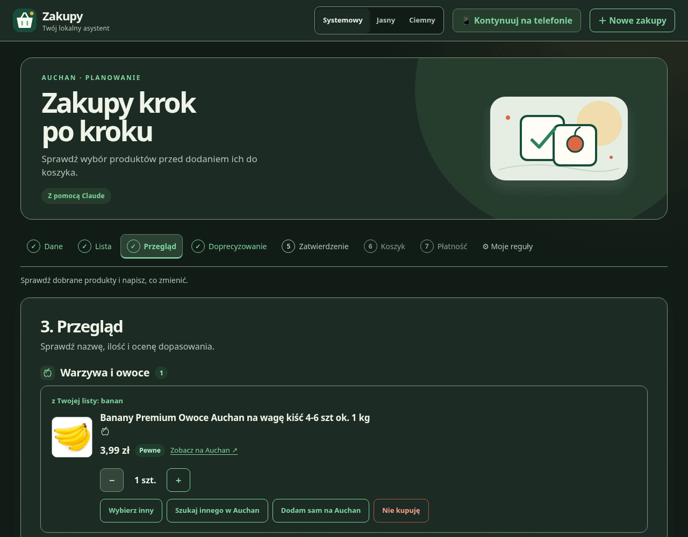
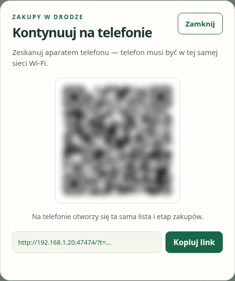
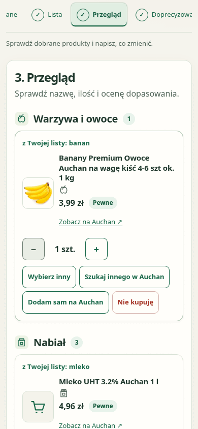

# 🛒 auchan-shopping-harness

**Paste your shopping list, get a filled Auchan cart.** A small app that runs on your own computer. It knows what you usually buy, picks the products, asks only about what it isn't sure of and adds everything to your [zakupy.auchan.pl](https://zakupy.auchan.pl) cart. You check the cart and pay on Auchan yourself, so the app never pays or places an order.

```
📝 your list  →  🔎 matched products  →  ❓ a few questions  →  ✅ approve  →  🛒 cart filled  →  💳 you pay on Auchan
```

<p align="center">
  
  
</p>

---

## 🚀 First time: set up (5 minutes)

**You need:** [Node.js](https://nodejs.org) 26+, Chromium, an Auchan account with at least a few past orders and, optionally, the [Claude Code](https://claude.com/claude-code) CLI. Claude reads free-form lists and handles **Powiedz, co zmienić**. Without it the app still works: write one product per line (`mleko 2`) and it asks about every doubtful match.

1. **Install:**
   ```bash
   npm install
   ```
2. **Get your order history:**
   ```bash
   npm run sync
   ```
   🔐 A browser window opens on Auchan. **Log in and leave the window open.** The app saves your login, closes the window and downloads your orders and the current promotions. This is how it learns what you usually buy.
3. **Optional: get product photos:**
   ```bash
   npm run sync images
   ```

---

## 🧺 Every time: do the shopping

```bash
npm run app
```

Open the link it prints (`http://127.0.0.1:47474/?t=…`). 💡 **Bookmark it.** The link stays the same every time you start the app.

### 📱 Continue on your phone

Click **📱 Kontynuuj na telefonie** in the top bar and scan the QR code with the phone's camera (the terminal shows the same code at start-up). The phone must be on the same Wi-Fi. It opens the same trip at the same step, so you can make the list at the desk and finish it in the kitchen.

<p align="center">
  
  
</p>


Then follow the steps at the top of the page:

| Step | What you do |
|---|---|
| **1 · Dane** 📦 | See how fresh your data is. Click **Odśwież dane** if it's old. |
| **2 · Lista** 📝 | Paste your list the way you'd write it: `mleko 2`, `chleb`, `ser żółty, gouda albo edam`. Tick **Dodaj to, co zwykle kupuję** to add the things you buy every time. You can set a budget. |
| **3 · Przegląd** 👀 | Check what was found. Products are grouped by category. |
| **4 · Doprecyzowanie** ❓ | Answer the few questions about doubtful matches. Click **Zobacz na Auchan ↗** to see a product on the shop's page. |
| **5 · Zatwierdzenie** ✅ | One last look, then **Zatwierdź i dodaj do koszyka**. |
| **6 · Koszyk** 🛒 | Watch the products land in your Auchan cart. |
| **7 · Płatność** 💳 | Read the report and go to Auchan to check and pay. |

### 🔧 Not happy with a product?

Every line has four buttons:

- 🔄 **Wybierz inny:** pick another of the suggested products.
- 🔎 **Szukaj innego w Auchan:** look for something else in the shop.
- ✋ **Dodam sam na Auchan:** you'll add it yourself; it goes on a short reminder list.
- 🚫 **Nie kupuję:** drop it from this trip.

💬 You can also type what you want in **Powiedz, co zmienić**, for example *"weź większe mleko"*. Claude proposes the change and nothing happens until you click **Przyjmij**.

### 🧠 It learns from you

Each time you pick a different product, the app remembers it for next time. Open the **Moje reguły** tab to see what it learned, remove a rule or block a product you never want (all Szymanowska flours are blocked from the start).

### 💡 Good to know

- 🕰️ **"· cena z 7 sie"** next to a price means the price is old (more than 30 days). The real price on Auchan may differ.
- 🔎 **A product the app has never seen?** Click **Szukaj w Auchan**. A browser window opens. If Auchan shows a captcha, solve it by hand; the app waits. If Auchan refuses, searching pauses for 24 hours.
- 🔁 **Cart filling stopped?** The message says whether running it again is safe. A second run never adds anything twice and never removes anything from your cart.
- 🔄 **New order delivered?** Run `npm run sync` (or click **Odśwież dane**) so the app learns from it.
- 🌙 **Dark mode:** use the switch in the top bar.

---

## 🔒 Your data and safety

- 🏠 **Everything stays on your computer** in `.state/`. Only your list, product names and prices go to Anthropic when Claude reads the list. Order numbers, your address and your login never do.
- 💳 **The app never pays.** It can't open the payment pages, even by mistake.
- 🍪 **It keeps only the login cookie** for Auchan, nothing else.
- 📶 **On your Wi-Fi, the link is the key.** The app answers on this computer and on its home-network address only, and every request needs the token in the link. The Wi-Fi traffic is plain HTTP, so don't run the app on public Wi-Fi. To change the key, stop the app, run `rm .state/app-token` and start it again; old links and bookmarks stop working.
- 🛑 **If Auchan says no, it stops.** No retries and no getting around Auchan's bot protection.

🗑️ **Delete everything:**

```bash
rm -rf .state tests/fixtures/raw ~/.cache/chrome-devtools-mcp/zakupy
```

Then log out on Auchan if you also want the session ended there.

---

## 🧰 Other commands

| Command | What it's for |
|---|---|
| `npm run sync` | 🔄 Refresh orders and promotions (`orders` / `promotions` / `images` for one part) |
| `npm run sync placed <orderId>` | 📦 Learn an order that is placed but not delivered yet |
| `npm run sync check` | 🩺 Test the connection without saving anything |
| `npm run search-auchan -- <term>…` | 🔎 Search Auchan from the terminal (up to 10 terms) |
| `npm run fill` | 🛒 Fill the cart from a basket approved in the chat |
| `/zakupy` in Claude Code | 💬 Do the whole shopping in a chat instead of the app |
| `npm test` | ✅ Run the tests |

<details>
<summary>🛠️ For developers</summary>

- **Stack:** Node 26 running TypeScript directly, `node:sqlite`, `node:test`, `playwright-core` for the login window only, and a plain HTML/JS page in `public/`. No build step.
- **Data:** `.state/harness.db` (orders, prices, promotions, learned rules) and `.state/trip.json` (the current trip).
- **Talking to Auchan:** plain HTTP with the saved session (`src/http-worker.ts`). Every path is allowlisted (`src/worker.ts`) and requests are paced. The cart is only added to, in batches of 10, and never lowered or emptied.
- **Claude:** `claude -p` with no tools, MCP servers, settings or saved session, in an empty temporary directory. Its output is a closed set of operations that the server validates (`src/app/`).
- **App server:** listens on 127.0.0.1 and on one private Wi-Fi address (`lanAddresses()` skips container and VPN interfaces), with a token in `.state/app-token`. It checks the Host and Origin headers and sets a strict CSP. `GET /api/phone` and `/phone-qr.svg` serve the phone link and its QR code (`qrcode-generator`, no dependencies). The design is in `docs/superpowers/specs/`.
- **MCP server** `auchan-data` (`.mcp.json`): reads and writes the local database only, for the `/zakupy` chat flow.
- **Hooks** (`.claude/settings.json`): `tools/fill-guard.ts` blocks the browser tools while a fill runs. `tools/checkout-guard.ts` always blocks checkout and payment pages.
- `npm run replay` measures how well the "usual" list predicts your last 5 orders.

</details>
